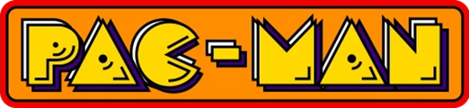
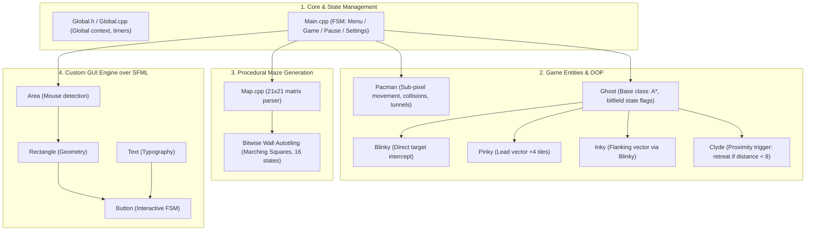
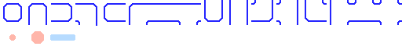
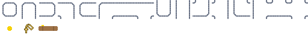
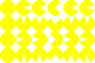

# Pacman (C++ / SFML)

<p align="center">
  
</p>

<p align="center">
  
  
  
  
  
</p>

<p align="center">
  <a href="README.md"><b>Read in English</b></a> | <a href="README_RU.md"><b>Читать на русском</b></a>
</p>

This repository contains a complete, standalone desktop implementation of the classic arcade game Pacman written in **C++** using the **SFML** multimedia library. The project includes full source code, Visual Studio solution files, ready-to-run precompiled binaries with runtime dependencies, original hand-crafted sprite atlases, customizable maze definitions, and a persistent highscore system.

---

## Table of Contents

- [Repository Structure](#repository-structure)
- [Architecture & Application Logic](#architecture--application-logic)
- [Ghost Behavior & Artificial Intelligence](#ghost-behavior--artificial-intelligence)
- [Graphical Assets](#graphical-assets)
  - [Visual Themes](#visual-themes)
  - [Character Spritesheets](#character-spritesheets)
- [Gameplay & Controls](#gameplay--controls)
- [Level Map Format](#level-map-format)
- [How to Run and Build](#how-to-run-and-build)
  - [Instant Play](#instant-play-no-build-required)
  - [Build with Visual Studio](#build-with-visual-studio)
- [License](#license)

---

## Repository Structure

The repository provides everything required to inspect, build, modify, and run the game:

| Folder / File | Purpose |
| :--- | :--- |
| **`Headers/`** | C++ header files (`.h`): declarations for entities (Pacman, 4 ghosts, maze map, custom UI components, global settings). |
| **`Materials/`** | Graphical and audio assets: hand-drawn spritesheets, maze wall tiles, backgrounds, title logos, icon, and font. |
| **`Maps/`** | Plain-text maze files (`Map_Standart.txt`, `Map_Labyrinth.txt`, `Map_Loops.txt`, etc.). |
| **`Settings/`** | Configuration files: available level roster (`Maps.txt`), active themes (`LevelColors.txt`), and graphics settings (`Settings.txt`). |
| **`Highscores/`** | Persistent per-map leaderboard score files. |
| **`Main.cpp`**, **`*.cpp`** | Source files implementing core gameplay, game loop, ghost artificial intelligence, and user interface. |
| **`Pacman.sln`**, **`Pacman.vcxproj`** | Solution and project files for Microsoft Visual Studio. |
| **`Pacman.exe`** | Standalone precompiled game executable for Windows. |
| **`*.dll`** | Dynamic runtime libraries for SFML (`sfml-graphics`, `sfml-window`, `sfml-system`, `sfml-audio`, `sfml-network`) and OpenAL. |

---

## Architecture & Application Logic

The application coordinates its subsystems through a modular structure:



### Core Logic Overview:
- **Game State Machine (FSM):** Manages transitions between the main menu, settings dialog, active gameplay session, pause overlay, game over, and victory screens.
- **Delta-Time Scaled Movement:** Movement velocities are scaled by frame duration (`_Settings::__ElapsedTime`), maintaining consistent game speed regardless of monitor refresh rate.
- **Continuous-Discrete Grid Projection:** Character positions move with sub-pixel floating-point smoothness, while collisions, dot consumption, and pathfinding queries project onto a discrete $21 \times 21$ tile matrix.
- **Lightweight Custom GUI:** Menus and buttons are constructed using an internal component hierarchy (`Area` -> `Rectangle` -> `Text` -> `Button`) that dispatches mouse events without external heavyweight dependencies.

---

## Ghost Behavior & Artificial Intelligence

The game implements canonical ghost behaviors with distinct targeting heuristics powered by the **A\*** (A-Star) pathfinding algorithm:

```
                              [ Pacman ]
                                  ▲
        ┌────────────────┬────────┴────────┬────────────────┐
        │ Direct Pursuit │ Ambush (+4 sq.) │ Flank Vector   │ Scatter / Flee
        │                │                 │                │ (if closer than 8 sq.)
        ▼                ▼                 ▼                ▼
   [ Blinky 🔴 ]    [ Pinky 🌸 ]      [ Inky 🔷 ]      [ Clyde 🟠 ]
```

| Ghost | Sprite | Target Cell Selection Logic |
| :--- | :---: | :--- |
| **Blinky** (Red) |  | **Direct Chaser:** Directly targets Pacman's current coordinate. The most relentless pursuer. In scatter phase, patrols the top-right corner. |
| **Pinky** (Pink) |  | **Ambusher:** Targets 4 tiles ahead of Pacman's current heading direction to cut off escape corridors. |
| **Inky** (Cyan) |  | **Flanker:** Constructs a vector from Blinky's coordinates to the spot ahead of Pacman and doubles it to execute pincer maneuvers. |
| **Clyde** (Orange) |  | **Proximity Trigger:** Pursues Pacman when distance $\ge 8$ tiles; retreats toward home corner when closing in closer than 8 tiles. |

### Ghost State Cycles:
- **Chase:** Active pursuit toward computed target coordinates along shortest navigable paths.
- **Scatter:** Timed periodic disengagement where ghosts return to loop around their home quadrant corners.
- **Frightened:** Triggered upon energizer consumption. The A\* pathfinder inverts node costs, routing ghosts away from Pacman at reduced speed.
- **Eaten:** Defeated ghost eyes chart an expedited A\* path directly back to the central spawn house to revive.

---

## Graphical Assets

All graphical resources (character animations, ghost states, death sequences, and maze structure blocks) were drawn by hand. The assets are stored in the `Materials/` folder as structured horizontal spritesheets.

### Visual Themes

Three visual styles are included and selectable from the game's settings menu:

| Theme | Maze Wall Tiles (`Map32_*.png`) | Ghost Spritesheet (`Ghost32_*.png`) | Description |
| :--- | :---: | :---: | :--- |
| **Default** |  |  | Classic arcade color scheme with blue maze walls and canonical ghost colors. |
| **Cyber** |  |  | High-tech neon theme with circuit-style walls and futuristic apparitions. |
| **Spooky** |  |  | Dark gothic Halloween theme with stone masonry and eerie spirits. |

All texture sheets are provided in three native resolution tiers: **16×16**, **32×32**, and **64×64** pixels (`Materials/*16.png`, `*32.png`, `*64.png`), allowing window scaling without pixel blur or distortion.

### Character Spritesheets

| Movement Sequence (`Pacman32.png`) | Death Sequence (`PacmanDeath32.png`) |
| :---: | :---: |
|  |  |

---

## Gameplay & Controls

- **Wall Autotiling:** Maze walls automatically resolve their visual shapes (corners, straight runs, T-junctions, crossways) based on neighbor analysis.
- **Seamless Tunnels:** Side tunnels project duplicate sprites across opposite boundaries to eliminate edge clipping.
- **Leaderboards:** Per-map persistent record tables saved to the `Highscores/` directory.

### Controls:
- **Movement:** `W`, `A`, `S`, `D` or Arrow Keys (`Up`, `Left`, `Down`, `Right`).
- **Pause:** `Escape`.
- **Menu Navigation:** Left Mouse Click.

---

## Level Map Format

Mazes are stored under `Maps/` as plain text matrices containing $21 \times 21$ values:

```text
1 4 4 4 4 4 4 4 4 4 4 4 4 4 4 4 4 4 4 4 1
1 4 3 3 3 3 3 3 3 3 3 3 3 3 3 3 3 3 3 4 1
...
```

- `0` — Ghost house door (permeable only to ghosts);
- `1` — Empty walkable corridor;
- `2` — Energizer (power pellet);
- `3` — Pellet (regular dot);
- `4` — Wall (dynamically styled by autotiling);
- `5` — Pacman starting position;
- `6..9` — Ghost spawn positions (Blinky, Pinky, Inky, Clyde).

To add a custom level, place `Maps/Map_CustomName.txt` in the folder and register its name in `Settings/Maps.txt`.

---

## How to Run and Build

### Instant Play (No Build Required)
The repository includes precompiled binaries and all required dependencies:
1. Clone the repository:
   ```powershell
   git clone https://github.com/MalenkiySolovey/Pacman.git
   ```
2. Double-click **`Pacman.exe`** in the root folder to launch the game.

### Build with Visual Studio
1. Open the solution file **`Pacman.sln`** in Microsoft Visual Studio (2019 or 2022).
2. Select configuration **`Release`** or **`Debug`** (platform **`x86`**).
3. Press `F5` or `Ctrl + Shift + B` to build and run. SFML headers and libraries are configured with relative project paths.

---

## License

This project is distributed under the **GNU General Public License v3.0 (GPLv3)**. For the full license text, see [LICENSE](LICENSE).
