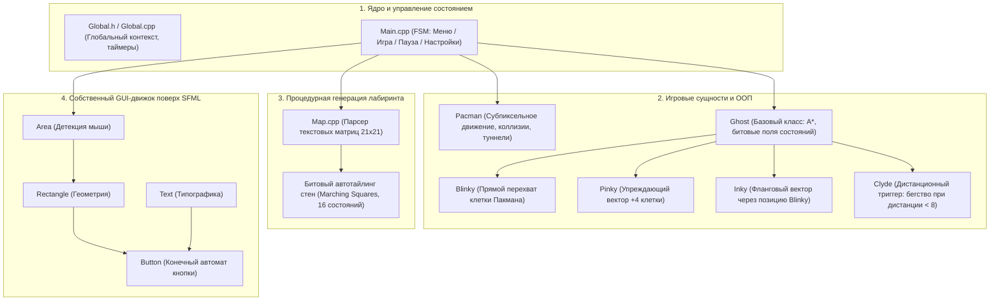

# Pacman (C++ / SFML)

<p align="center">
  
</p>

<p align="center">
  
  
  
  
  
</p>

<p align="center">
  <a href="README.md"><b>Read in English</b></a> | <a href="README_RU.md"><b>Читать на русском</b></a>
</p>

Репозиторий содержит законченный проект классической аркадной игры Pacman, написанный на **C++** с использованием мультимедийной библиотеки **SFML**. В проект входят исходный код, решение для Visual Studio, готовый к запуску бинарник с необходимыми библиотеками, набор авторских текстур ручной работы, сменные темы, конфигурации уровней и система рекордов.

---

## Содержание

- [Состав репозитория](#состав-репозитория)
- [Архитектура и логика работы приложения](#архитектура-и-логика-работы-приложения)
- [Поведение и искусственный интеллект привидений](#поведение-и-искусственный-интеллект-привидений)
- [Графические материалы репозитория](#графические-материалы-репозитория)
  - [Стилистические темы](#стилистические-темы)
  - [Спрайты персонажей](#спрайты-персонажей)
- [Игровой процесс и управление](#игровой-процесс-и-управление)
- [Работа с картами уровней](#работа-с-картами-уровней)
- [Как запустить и собрать проект](#как-запустить-и-собрать-проект)
  - [Быстрый запуск](#быстрый-запуск-без-сборки)
  - [Сборка в Visual Studio](#сборка-в-visual-studio)
- [Лицензия](#лицензия)

---

## Состав репозитория

В репозитории содержатся все необходимые компоненты для изучения, сборки и мгновенного запуска игры:

| Каталог / Файл | Назначение |
| :--- | :--- |
| **`Headers/`** | Заголовочные файлы (`.h`): описание сущностей игры (Пакман, 4 привидения, лабиринт, компоненты UI, глобальные настройки). |
| **`Materials/`** | Графические и аудио-ресурсы: авторские спрайтшиты персонажей, тайлы лабиринта, фоны, логотипы, иконка и шрифт. |
| **`Maps/`** | Текстовые файлы лабиринтов (`Map_Standart.txt`, `Map_Labyrinth.txt`, `Map_Loops.txt` и др.). |
| **`Settings/`** | Конфигурационные файлы: списки доступных карт (`Maps.txt`), тем оформления (`LevelColors.txt`) и параметров графики (`Settings.txt`). |
| **`Highscores/`** | Файлы сохранения лучших результатов для каждого уровня. |
| **`Main.cpp`**, **`*.cpp`** | Исходный код логики игры, игрового цикла, ИИ противников и пользовательского интерфейса. |
| **`Pacman.sln`**, **`Pacman.vcxproj`** | Файлы решения и проекта для сборки в Microsoft Visual Studio. |
| **`Pacman.exe`** | Скомпилированный готовый бинарник игры для Windows. |
| **`*.dll`** | Динамические библиотеки рантайма SFML (`sfml-graphics`, `sfml-window`, `sfml-system`, `sfml-audio`, `sfml-network`) и OpenAL. |

---

## Архитектура и логика работы приложения

Структура приложения построена на модульном взаимодействии основных подсистем:



### Основные принципы работы:
- **Конечный автомат игры (FSM):** Управляет переключением между главным меню, экраном настроек, активной игрой, экраном паузы, победой и поражением.
- **Игровой цикл с Delta-Time:** Перемещение персонажей рассчитывается пропорционально реальному прошедшему времени между кадрами (`_Settings::__ElapsedTime`), что гарантирует одинаковую скорость игры независимо от частоты кадров.
- **Дискретно-непрерывная сетка:** Координаты персонажей вычисляются в вещественных числах с субпиксельной плавностью, а коллизии со стенами и поедание точек проецируются на дискретную матрицу ячеек $21 \times 21$.
- **Собственный интерфейс (GUI):** Меню и кнопки построены на базе легковесной иерархии классов (`Area` -> `Rectangle` -> `Text` -> `Button`), реагирующих на события мыши без сторонних тяжелых библиотек.

---

## Поведение и искусственный интеллект привидений

В игре реализована классическая модель поведения привидений с индивидуальными алгоритмами поиска цели на основе алгоритма **A\*** (A-Star):

```
                              [ Pacman ]
                                  ▲
        ┌────────────────┬────────┴────────┬────────────────┐
        │ Прямая погоня  │ Засада (+4 кл.) │ Фланговый удар │ Патруль / Побег
        │                │                 │                │ (если ближе 8 кл.)
        ▼                ▼                 ▼                ▼
   [ Blinky 🔴 ]    [ Pinky 🌸 ]      [ Inky 🔷 ]      [ Clyde 🟠 ]
```

| Привидение | Спрайт | Логика выбора цели (Target Cell) |
| :--- | :---: | :--- |
| **Blinky** (Красный) |  | **Прямое преследование:** Постоянно целится в текущую координату клетки Пакмана. Самый агрессивный противник. |
| **Pinky** (Розовый) |  | **Засада:** Целится на 4 клетки вперед по направлению движения Пакмана, перехватывая пути к отступлению. |
| **Inky** (Голубой) |  | **Фланговый маневр:** Вычисляет вектор от позиции Blinky к точке перед Пакманом и удваивает его (атака в клещи). |
| **Clyde** (Оранжевый) |  | **Дистанционный триггер:** Преследует Пакмана, если расстояние $\ge 8$ клеток; если подходит ближе — пугается и отступает в свой угол. |

### Фазы поведения призраков:
- **Chase (Погоня):** Призраки активно двигаются к своим целевым точкам по кратчайшему пути через лабиринт.
- **Scatter (Рассредоточение):** Призраки временно прерывают погоню и патрулируют свои закрепленные углы карты.
- **Frightened (Испуг):** Активируется взятием энерджайзера — привидения синеют, замедляются и убегают от игрока по инвертированному алгоритму A\*.
- **Eaten (Возврат глаз):** Съеденный призрак в виде глаз на максимальной скорости возвращается в домик для возрождения.

---

## Графические материалы репозитория

Все текстуры игры (персонажи, фазы движения, анимации гибели, привидения и структурные блоки лабиринта) нарисованы вручную. Материалы подготовлены в папке `Materials/` в виде горизонтальных спрайтшитов.

### Стилистические темы

В репозиторий включены три полноценных визуальных стиля, переключаемых в меню игры:

| Тема | Тайлы окружения (`Map32_*.png`) | Спрайтшит привидений (`Ghost32_*.png`) | Описание темы |
| :--- | :---: | :---: | :--- |
| **Default** |  |  | Классическая аркадная палитра синего лабиринта и ярких привидений. |
| **Cyber** |  |  | Неоновый стиль с высокотехнологичными микросхемами и кибер-призраками. |
| **Spooky** |  |  | Мрачный хэллоуинский стиль с каменными стенами и фантомами. |

Все текстуры предоставлены сразу в трех масштабах: **16×16**, **32×32** и **64×64** пикселей (`Materials/*16.png`, `*32.png`, `*64.png`), что позволяет изменять размер окна без смазывания пикселей.

### Спрайты персонажей

| Анимация движения (`Pacman32.png`) | Анимация гибели (`PacmanDeath32.png`) |
| :---: | :---: |
|  |  |

---

## Игровой процесс и управление

- **Автоматическая стыковка стен:** Лабиринт автоматически подбирает форму стен (углы, прямые, перекрестки) из текстурного атласа на основе анализа соседних блоков.
- **Бесшовные туннели:** При переходе через боковые туннели спрайт синхронно проецируется на противоположной стороне экрана, обеспечивая плавный визуальный переход без клиппинга.
- **Таблица рекордов:** Для каждой карты ведется независимый учет очков с сохранением в папку `Highscores/`.

### Управление:
- **Перемещение:** `W`, `A`, `S`, `D` или стрелки клавиатуры (`Вверх`, `Влево`, `Вниз`, `Вправо`).
- **Пауза:** `Escape`.
- **Навигация в меню:** Левая кнопка мыши.

---

## Работа с картами уровней

Лабиринты хранятся в папке `Maps/` в виде текстовых файлов размером $21 \times 21$ символ:

```text
1 4 4 4 4 4 4 4 4 4 4 4 4 4 4 4 4 4 4 4 1
1 4 3 3 3 3 3 3 3 3 3 3 3 3 3 3 3 3 3 4 1
...
```

- `0` — дверь домика привидений;
- `1` — свободный проход;
- `2` — энерджайзер (большая точка);
- `3` — обычная точка;
- `4` — стена лабиринта;
- `5` — стартовая позиция Пакмана;
- `6..9` — точки спавна привидений (Blinky, Pinky, Inky, Clyde).

Чтобы добавить в игру свой уровень, достаточно создать файл `Maps/Map_МойУровень.txt` и прописать название `МойУровень` в конфигурационном файле `Settings/Maps.txt`.

---

## Как запустить и собрать проект

### Быстрый запуск (без сборки)
В репозитории уже есть скомпилированный бинарник. Для запуска не требуется устанавливать сторонние библиотеки или среду разработки:
1. Клонируйте репозиторий:
   ```powershell
   git clone https://github.com/MalenkiySolovey/Pacman.git
   ```
2. Запустите файл **`Pacman.exe`** из корневой папки.

### Сборка в Visual Studio
1. Откройте файл решения **`Pacman.sln`** в Microsoft Visual Studio (2019 или 2022).
2. Выберите конфигурацию **`Release`** или **`Debug`** (платформа **`x86`**).
3. Нажмите `F5` или `Ctrl + Shift + B` для сборки. Библиотеки SFML привязаны по относительным путям.

---

## Лицензия

Проект распространяется под свободной лицензией **GNU General Public License v3.0 (GPLv3)**. Подробный текст лицензии приведен в файле [LICENSE](LICENSE).
